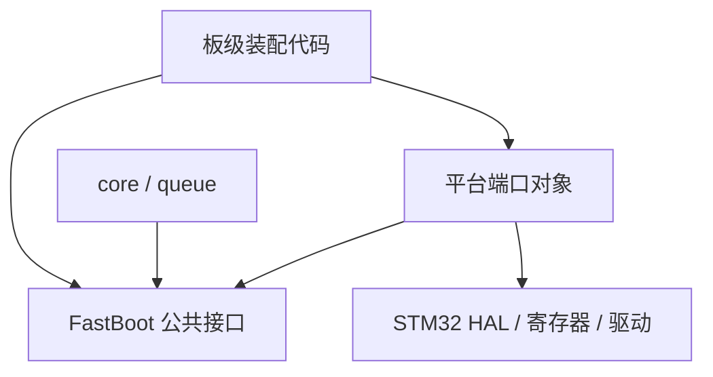
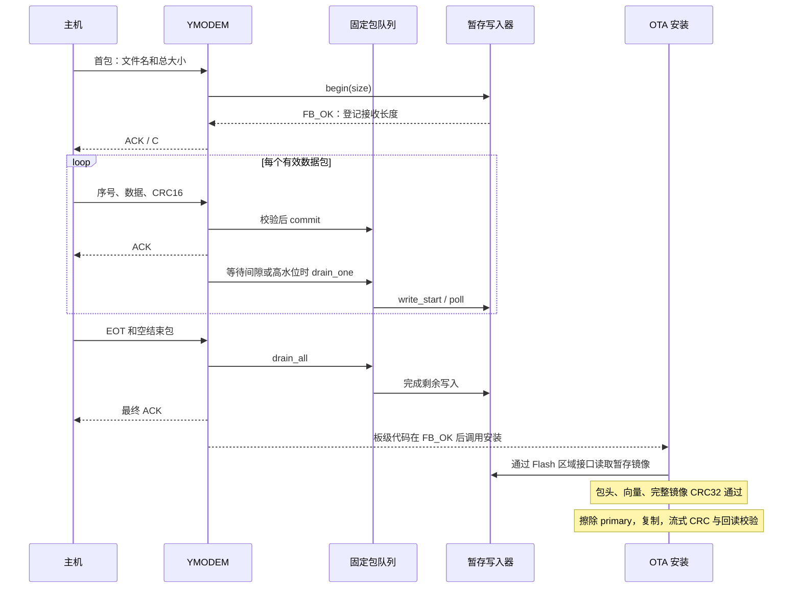
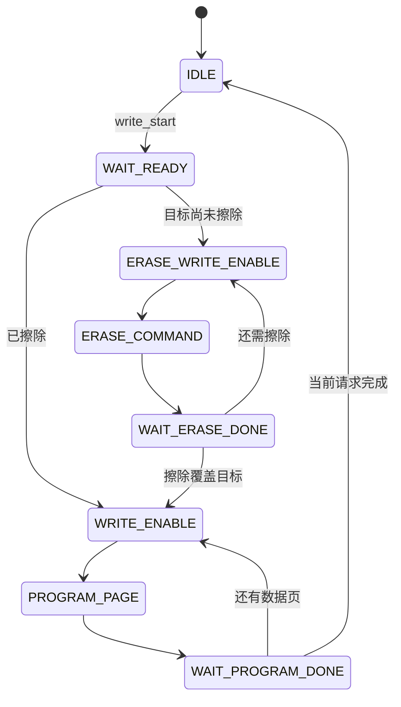
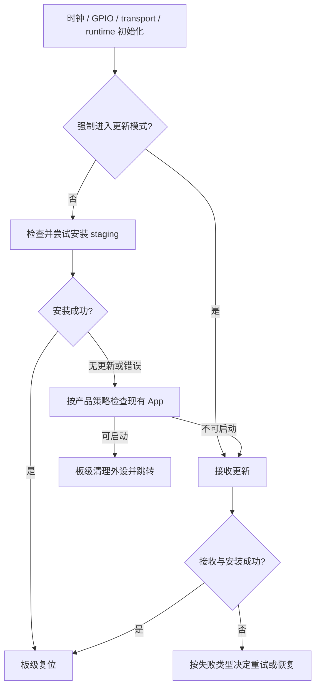

# FastBoot 软件架构教程：从一次固件更新理解分层、接口与状态机

本教程面向能够阅读 C 代码、希望理解或移植 Bootloader 的开发者。阅读后，你应能回答三个问题：一次更新由哪些模块协作完成；更换通信或存储硬件时应该修改哪里；收到一个成功状态时，系统究竟完成了哪些工作。

本文依据当前仓库实现编写，包含擦除 App 前的完整镜像 CRC32 校验。源码链接均指向本仓库。STM32F411 的地址与容量是参考板配置，移植时应根据目标芯片重新确定。

## 阅读路线

1. [建立系统模型](#1-建立系统模型)
2. [理解分层和依赖](#2-理解分层和依赖)
3. [沿一次更新追踪数据](#3-沿一次更新追踪数据)
4. [使用函数表与上下文](#4-使用函数表与上下文)
5. [实现字节传输接口](#5-实现字节传输接口)
6. [区分 writer 与 Flash 区域](#6-区分-writer-与-flash-区域)
7. [理解队列和缓冲区所有权](#7-理解队列和缓冲区所有权)
8. [理解协作式异步写入](#8-理解协作式异步写入)
9. [阅读 YMODEM 接收状态机](#9-阅读-ymodem-接收状态机)
10. [理解 FWOT 与多层校验](#10-理解-fwot-与多层校验)
11. [理解 staging 的职责与边界](#11-理解-staging-的职责与边界)
12. [由板级代码装配系统](#12-由板级代码装配系统)
13. [配置和构建](#13-配置和构建)
14. [移植到新平台](#14-移植到新平台)
15. [计算内存和吞吐预算](#15-计算内存和吞吐预算)
16. [组织验证与故障定位](#16-组织验证与故障定位)
17. [编写 Doxygen 注释](#17-编写-doxygen-注释)
18. [按架构阅读源码](#18-按架构阅读源码)

## 1. 建立系统模型

一个可更新设备通常需要以下角色：

| 角色 | 保存或执行的内容 | 在本实现中的位置 |
| --- | --- | --- |
| 主机发送工具 | 发送固件文件，执行 YMODEM 握手 | 目标工程的主机工具 |
| Bootloader | 上电决策、接收更新、安装、跳转 | 目标工程的板级代码 |
| FastBoot 库 | 协议、包队列、FWOT 校验与安装 | 本仓库 |
| staging | 保存下载到的完整固件包 | 参考端口的 W25Q64 OTA 区 |
| primary | 保存 CPU 最终执行的 App 镜像 | 参考端口的内部 Flash App 区 |
| App | 产品业务功能 | 独立的应用工程 |

参考板的内部 Flash 分成 32 KiB Bootloader 与 480 KiB App，App 起址为 `0x08008000`。外部 W25Q64 的 OTA 暂存区容量为 4 MiB。这三个区域的作用不同：Bootloader 执行安装程序，staging 保存 FWOT 文件，primary 保存去掉包头后的可执行镜像。

```text
主机中的 app.fwot
    │ YMODEM
    ▼
W25Q64 staging：[64 字节 FWOT 包头][App 镜像]
    │ 包头、向量、完整镜像 CRC32 校验
    │ 通过后擦除并复制
    ▼
内部 Flash primary：[App 镜像]
    │ 写入时 CRC32 + 安装后回读 CRC32
    ▼
板级代码复位或跳转到 App
```

App 本身必须链接到预定的 primary 地址。把为其他地址生成的二进制复制过来，并不能自动完成地址重定位；中断向量表、链接脚本和启动代码需要一起适配。

## 2. 理解分层和依赖

### 2.1 每层回答不同问题

| 层 | 负责回答的问题 | 主要文件 |
| --- | --- | --- |
| 板级装配层 | 何时更新、如何初始化板子、成功后如何启动 App？ | 目标工程的 `main`、时钟、GPIO、链接脚本 |
| 协议层 | 哪些字节构成一个包、何时 ACK、如何结束接收？ | [fastboot_ymodem.c](../src/core/fastboot_ymodem.c) |
| 队列层 | 数据放在哪里、什么时候可以回收缓冲区？ | [fastboot_queue.c](../src/queue/fastboot_queue.c) |
| 安装层 | 包是否合法、何时擦除 App、如何确认写入成功？ | [fastboot_ota.c](../src/core/fastboot_ota.c) |
| 暂存检测层 | 上电时是否存在需要尝试安装的 FWOT 包？ | [fastboot_staging.c](../src/core/fastboot_staging.c) |
| 平台端口层 | 如何读取 UART、擦写 Flash、取得时间？ | [STM32F4 端口](../port/stm32f4) |
| 接口层 | 各模块以什么结构和契约交互？ | [include](../include) |

板级装配层位于使用 FastBoot 的工程中。本仓库提供可复用的核心库和参考端口，完整的 MCU 启动文件、时钟树和产品启动策略由目标工程提供。

### 2.2 区分编译依赖和运行调用



这张图表示源代码依赖。核心层包含 FastBoot 的抽象头文件；平台端口也包含同一组头文件并实现它们。核心层不需要包含 `stm32f4xx_hal.h`。

运行时则会发生：`core → 函数指针 → port → HAL → 硬件`。调用进入硬件驱动，并不要求核心代码在编译时认识具体驱动。这就是此项目使用的依赖倒置：高层流程面向接口，端口实现接口，由装配层把两者连接起来。

例如，更换 W25Q64 为另一颗 SPI Flash，首先检查和实现 writer、Flash 区域回调；修改芯片命令和擦写边界的工作放在端口层。协议层仍处理 YMODEM 包。

### 2.3 接口如何减少修改范围

| 变化 | 主要修改位置 | 需要保持的契约 |
| --- | --- | --- |
| UART 改为 USB CDC | transport 端口 | 短读、非阻塞读取、单字节发送 |
| 更换外部 Flash | writer、Flash ops | 地址范围、完成状态、缓冲区生命周期 |
| 修改 App 地址 | 板级内存布局、策略、App 链接脚本 | load_addr 与向量检查一致 |
| 开启硬件看门狗 | runtime 端口与板级初始化 | 喂狗时机、耗时操作的最长间隔 |
| 更换接收协议 | 新协议模块与装配层 | 数据写入与安装接口保持一致 |

## 3. 沿一次更新追踪数据



数据包 ACK 表示包经过协议检查并被接收流程接受。此时包可能仍在 RAM 队列中，Flash 编程尚未完成。因此主机收到某个数据包 ACK，不能据此判断固件已持久保存。

当前结束流程在空结束包处排空队列，再发送最终 ACK，并检查接收与写入字节数。板级程序还需要依据 `fastboot_ymodem_receive()` 的返回值判断接收是否成功，之后调用安装 API。主机进度达到 100% 与 App 已安装启动，属于两个阶段。

## 4. 使用函数表与上下文

FastBoot 通过函数表加 `ctx` 指针，把操作与实例状态组织在一起。以传输接口为例：

```c
typedef struct {
    size_t (*read)(void *ctx, uint8_t *buf, size_t len, uint32_t timeout_ms);
    void (*write_byte)(void *ctx, uint8_t byte);
    void *ctx;
} fastboot_transport_t;
```

`read` 指明“如何读取”，`ctx` 指明“这次读取使用哪个对象”。回调可以把 `ctx` 转换成自己的类型，从中找到 UART 句柄、环形缓冲区或软件读指针。

```c
/* 展示接口装配；具体 UART 操作由 board_uart_read/write_byte 实现。 */
typedef struct {
    uint32_t channel;
} board_uart_ctx_t;

extern size_t board_uart_read(void *ctx, uint8_t *buf,
                             size_t len, uint32_t timeout_ms);
extern void board_uart_write_byte(void *ctx, uint8_t byte);

static board_uart_ctx_t s_uart_ctx = {1u};
static const fastboot_transport_t s_transport = {
    .read = board_uart_read,
    .write_byte = board_uart_write_byte,
    .ctx = &s_uart_ctx,
};
```

结构体初始化把具体对象“注入”核心流程。之后调用 `fastboot_ymodem_receive(&s_transport, ...)`，核心只需执行 `transport->read(transport->ctx, ...)`。

| 接口 | 职责 | 配置或状态的来源 |
| --- | --- | --- |
| `fastboot_transport_t` | 字节收发 | 通信端口 |
| `fastboot_writer_t` | 接收文件的写入生命周期 | 暂存写入器 |
| `fastboot_flash_ops_t` / `fastboot_flash_area_t` | 安装时访问一个有边界的存储区域 | 存储端口 |
| `fastboot_runtime_t` | 毫秒时基、看门狗服务 | 系统端口 |
| `fboot_log_t` | 可选字符串和数值日志 | 装配层或端口 |
| `fastboot_image_policy_t` | 加载地址、最大镜像大小、向量校验策略 | 板级策略 |

接口对象、`ctx` 及其引用的内存，需要在相关调用和异步操作期间保持有效。参考端口多数返回静态对象的只读指针，调用者无需分配或释放。指针为 `const` 只限制通过这个指针修改接口对象，回调仍可以修改 `ctx` 指向的运行状态。

## 5. 实现字节传输接口

### 5.1 读取必须允许短读

`read(ctx, buf, len, timeout_ms)` 返回实际拷贝的字节数，可以小于 `len`，但不能大于 `len`。没有数据时返回 0。`timeout_ms=0` 时应立即读取已到达的数据并返回。

核心的 `io_read_exact()` 会反复短读，累计到需要的长度；它使用 runtime 的毫秒计数判断超时。读取返回 0 时，核心可以调用 `service_writer()` 推进 Flash 写入。将 `read(..., 0)` 实现成长时间阻塞，会改变这一调度方式。

### 5.2 STM32F4 参考实现

[fastboot_uart.c](../port/stm32f4/fastboot_uart.c) 用 DMA 环形接收保存字节，CPU 根据剩余传输计数取得写入位置，再从软件读位置拷贝数据：

```text
UART 字节 → DMA 环形缓冲区 → transport.read → YMODEM 包槽位
                 DMA 写入             CPU 读取
```

DMA 环形缓冲与包队列承担不同任务。前者吸收串口连续到达的字节；后者保存已经校验、等待写入 Flash 的完整包。

当前 head/tail 实现没有额外的 DMA 多圈溢出计数。CPU 长时间未消费时，不能仅凭 head 与 tail 相等区分“空”与“DMA 已覆盖一整圈”。移植时应结合 UART 速率、最长处理间隔与缓冲区容量判断是否需要溢出检测。

### 5.3 时间和日志也是接口契约

runtime 的 `tick_ms` 必须持续前进，使用无符号差值处理计数回绕。参考实现使用 `HAL_GetTick()`；如果 SysTick 未启动，协议超时判断就不能正常工作。

参考端口的 `feed_watchdog` 当前为空回调。配置开启喂狗调用并不等于已经刷新真实 IWDG；产品启用硬件看门狗时必须实现该回调，并检查同步擦写等长操作的最大喂狗间隔。

协议与日志共用串口时，装配层应协调输出时机。ACK、NAK、C、CAN 都是协议字节，把任意调试文本插入传输阶段可能影响主机解析。

## 6. 区分 writer 与 Flash 区域

### 6.1 writer 描述一次接收会话

writer 接口包含 `begin`、`write`、`write_start`、`poll`、`busy` 和 `ctx`。

| 回调 | 输入与行为 | 完成语义 |
| --- | --- | --- |
| `begin(size)` | 登记本次文件长度，检查容量，重置会话 | `FB_OK` 表示可以开始接收 |
| `write(offset, data, len)` | 同步保存一段文件数据 | `FB_OK` 表示本段已完成 |
| `write_start(offset, data, len)` | 启动或推进异步请求，可能借用输入指针 | 返回值与 `busy` 一起决定是否继续 poll |
| `poll()` | 推进活动请求 | `FB_BUSY` 继续调度，`FB_OK` 表示本请求完成 |
| `busy()` | 查询活动状态 | true 表示输入缓冲区仍可能被使用 |

队列只有在 `write_start`、`poll`、`busy` 三个回调均存在且异步配置开启时，才选择异步路径；否则使用同步 `write`。当前 YMODEM 接收入口还会检查 `begin` 和 `write` 非 NULL，因此为 YMODEM 提供异步 writer 时也需要提供同步 `write`。单独使用队列的能力与 YMODEM 入口要求应分别阅读。

W25Q64 的 `begin()` 只登记文件长度，不立即擦除整个暂存区。实际写入推进到尚未擦除的位置时，才发起对应擦除命令。

### 6.2 Flash 区域描述存储边界

```c
typedef struct {
    uint32_t offset;
    uint32_t size;
    const fastboot_flash_ops_t *ops;
    void *ctx;
} fastboot_flash_area_t;
```

调用 `fastboot_flash_area_read(area, relative_offset, ...)` 时，包装层先检查范围，再把地址转换为 `area->offset + relative_offset`，传给 `ops->read`。

例如，primary 的 `offset=0x08008000`，读取区域内偏移 `0x20`，底层收到 `0x08008020`。staging 的底层地址则通常是外部 Flash 芯片内的字节偏移。区分这两个地址空间，能避免把 MCU 内存映射地址直接发送成 SPI Flash 地址。

Flash 包装层检查区域、函数表、请求边界及起始地址加法溢出，不代替底层的全部参数和硬件检查。缓冲区有效性、页编程限制、擦除对齐，以及实际擦除覆盖范围，仍需端口与调用方共同保证。

### 6.3 两个接口为何同时存在

writer 面向“接收一个文件”的生命周期，便于延迟擦除、异步推进与容量检查。Flash 区域面向“访问一个存储区”，适合安装过程读取 staging、擦除 primary、写入和回读。

W25Q64 原始 `write` 和 Flash 区域的 write 回调不会自动擦除目标区域；OTA 暂存 writer 则负责按需擦除。这一区别影响移植者是否需要在写入前主动准备存储。

## 7. 理解队列和缓冲区所有权

队列是固定深度的环形槽位数组，由 `head`、`tail`、`count` 管理。每个槽位保存包缓冲区、目标偏移、有效数据长度和异步写入标志。

```text
alloc → 在槽位 packet 中接收包 → CRC16 / 序号检查
                                      │
                                      ▼
                                    commit
                                      │
                                      ▼
                              write_start / write
                                      │
                        FB_BUSY → 保留槽位并继续 poll
                                      │
                                成功完成并确认空闲
                                      │
                                      ▼
                            head 前移、count 减少
```

`alloc()` 返回 tail 对应槽位，但不增加 count。调用方填完包、offset 和 len 后再 `commit()`，该包才会被消费。连续 alloc 而不 commit 不会自动获得多个独立槽位。

writer 获得的指针是 `slot->packet + FASTBOOT_QUEUE_HEADER_SIZE`，跳过 3 字节协议包头。最后一包的数据长度根据文件声明大小截断，YMODEM 的填充字节不会进入最终 FWOT 文件。

异步 writer 保存的是槽位内的数据指针。若在芯片编程完成前复用槽位，指针仍有效但内容已经变化，可能造成错误固件写入。因此释放槽位的时机属于数据正确性的核心条件。

`written` 记录已完成写入的最高结束偏移，即 `max(written, slot.offset + slot.len)`。它用于当前连续文件写入场景，不能把这个值理解成支持任意乱序写入时的完整覆盖证明。

基本 reset、查询、alloc、commit 接口要求有效队列指针，commit 前还应保证已取得空闲槽位。队列没有锁或 ISR 并发保护；DMA 可以接收字节，但协议包队列由同一协作流程管理。

## 8. 理解协作式异步写入

### 8.1 在芯片内部等待期间让出 CPU

Flash 擦除或页编程包含两段时间：CPU 发送 SPI 命令和数据；芯片在内部完成擦写。参考驱动把第二段等待拆成可轮询状态。



发送擦除或编程命令后，驱动返回 `FB_BUSY`。下一次调用 `poll()` 读取状态寄存器，若芯片仍忙则再次返回，核心流程可以继续处理接收。

这里的异步指“芯片内部等待被拆分并协作推进”。当前 SPI 命令发送本身使用阻塞 HAL 调用；初始化和部分状态转换也在 poll 中同步执行。接口契约应据此评估单次调用的最长耗时。

### 8.2 什么触发下一次 poll

本实现没有独立的 Flash 线程。YMODEM 在以下位置推进队列：

- `io_read_exact()` 暂时读不到字节时，调用 `service_writer()`。
- 包队列到达 3/4 高水位时，主动消费。
- 队列满时，先消费再申请下一个槽位。
- 空结束包到达时，调用 `drain_all()` 排空剩余请求。

因此，writer 返回 `FB_BUSY` 只是表示待完成，调用方还必须安排后续推进。`drain_all()` 没有统一的总等待超时，端口的 `poll()` 应保证操作最终完成或返回错误，避免永久忙状态。

### 8.3 看懂吞吐提升的来源

```text
同步等待：接收包 A → 等擦除/写入 A → 接收包 B → 等写入 B

协作方式：接收包 A → 启动写入 A → 接收包 B / C
                         ↑              │
                         └── 等待间隙 poll ┘
```

队列吸收存储偶尔变慢的时间差，DMA 吸收 CPU 暂时不读串口的字节。Flash 长期平均写入速度仍必须能够处理输入；持续比输入慢时，有限 RAM 缓冲最终会填满。

## 9. 阅读 YMODEM 接收状态机

协议细节见 [YMODEM 模块说明](02-ymodem.md)。从架构角度，重点关注状态、数据去向和完成条件：

| 阶段 | 输入 | 主要动作 | 数据去向 |
| --- | --- | --- | --- |
| 等待首包 | 文件名、声明大小 | 请求 CRC 模式，解析元数据，调用 begin | 控制包缓冲区 |
| 接收数据 | SOH/STX 包 | 检查反序号与 CRC16，校验期望序号，commit 后 ACK | 包队列，再写 staging |
| 收到 EOT | 结束标记 | ACK，准备接收空结束包 | 控制流程 |
| 接收空结束包 | 序号 0、空文件名 | 排空队列，确认接收和写入长度 | 完成或返回错误 |

SOH 的载荷是 128 字节，STX 的载荷是 1024 字节。配置的包缓冲容量必须覆盖实际接收的包；参考配置使用 1024 字节。

内部 `expected_size` 是整份文件大小，`received` 是已接收的有效载荷字节数，`written` 是已完成暂存写入的结束偏移。成功结束要求后两者均等于声明大小。

包校验失败进入协议重试，连续错误超限返回 `FB_ERR_IO`；此 API 不执行 FWOT 完整镜像 CRC32 校验。CRC16 与文件格式校验分别由不同层完成。

当前实现遇到序号不匹配会 NAK，没有专门的“前一包已成功、ACK 丢失导致重复发送”幂等 ACK 分支。文件大小解析也需要结合包内字段边界和整数溢出进行产品级审查。新增发送工具时，应使用当前实现支持的单文件结束握手并检查兼容性。

接收使用静态队列和会话上下文，一个实例只支持一个活动会话。RTOS 中可把完整接收过程放进专用任务，并由该任务持有传输和存储对象；同时运行多个会话则需要进一步实例化状态。

## 10. 理解 FWOT 与多层校验

### 10.1 文件格式与执行镜像

FWOT 头部固定 64 字节，包含 magic、头部版本、镜像偏移、镜像长度、镜像 CRC32、加载地址等字段。头部位于 staging 相对偏移 0；镜像位于 `image_offset`，安装时只把 `image_size` 字节复制到 primary。

```text
header_crc32 = CRC32(完整 64 字节头部，将 header_crc32 字段置零)
image_crc32  = CRC32(image_offset 开始的 image_size 字节)
```

包头 CRC32 的范围包含置零后的 CRC 字段。公共 `fastboot_crc32()` 第一次传入 seed=0，后续分块调用传入上一次返回值：

```c
uint32_t crc = 0u;
crc = fastboot_crc32(first_chunk, first_len, crc);
crc = fastboot_crc32(next_chunk, next_len, crc);
```

文件生成工具与设备必须使用相同的头部布局、字节序和 CRC 约定。当前头部通过紧缩结构体读取，参考目标采用小端序。

### 10.2 不同校验各自确认什么

| 校验 | 时机 | 确认内容 | 尚未证明的内容 |
| --- | --- | --- | --- |
| 包 CRC16 | 接收每包时 | 本包载荷通过链路校验 | 整个文件已存储、可安装 |
| 包头 CRC32 | 安装前 | FWOT 描述字段一致 | 完整镜像内容正确 |
| 大小、地址、向量策略 | 安装前 | 当前镜像符合目标布局约束 | App 业务运行正确 |
| staging 完整镜像 CRC32 | 擦除 primary 前 | 暂存的全部镜像数据与包头一致 | 内部 Flash 已写入 |
| 写入时流式 CRC32 | 复制完成后 | 复制时读取的全部镜像数据一致 | Flash 实际内容一致 |
| primary 回读 CRC32 | 写入完成后，按配置启用 | 内部 Flash 内容与预期一致 | 上电启动和业务表现正确 |

CRC 用于检测数据损坏。当前没有签名验证，也没有依据 `image_version` 实施的防回滚策略；需要固件来源认证的产品应补充密钥、签名和版本策略。

### 10.3 当前安装顺序

```text
读包头 → 校验包头与范围 → 验证镜像前 8 字节向量
       → 分块读取 staging 全镜像并计算 CRC32
       → CRC 通过 → 擦除 primary 全区
       → 分块读 staging、累积流式 CRC、写 primary
       → 比较流式 CRC → 可选完整回读 CRC → FB_OK
```

预校验复用静态 1 KiB 缓冲区，每处理一块调用喂狗包装函数。它增加一次外部 Flash 全镜像读取与 CRC 计算，避免在收到损坏包时先擦除旧 App。

预校验不是“安装前随意关闭的附加选项”。`FASTBOOT_CFG_ENABLE_READBACK_VERIFY` 只控制安装后的回读，关闭它不会跳过擦除前完整镜像 CRC 校验。

## 11. 理解 staging 的职责与边界

`fastboot_staging_install_if_pending()` 做三件事：读取起始 magic；匹配 FWOT 时调用完整安装；安装成功后请求清除 magic。

| 情况 | 返回值和行为 |
| --- | --- |
| magic 不匹配 | `FB_NO_UPDATE`，不尝试安装 |
| magic 匹配但包损坏 | 安装错误；预校验失败时旧 App 不被擦写 |
| 包正确且安装成功 | `FB_OK`，随后尝试清理 staging |
| staging 功能关闭 | `FB_NO_UPDATE` |

magic 是“需要尝试安装”的线索，不是可靠的接收完成记录。接收中断后，首部可能已经写入；下次启动仍可能进入检查，此时完整镜像 CRC 用于拒绝损坏内容。

清理调用请求擦除起始 1 字节。W25Q64 端口会将其扩展为所在的 4 KiB 扇区，所以它不保证只改变一个字节。分区设计必须考虑物理擦除边界。

当前实现忽略这次清理的错误。即使安装返回 `FB_OK`，magic 也可能仍存在，下次启动可能重复安装。板级策略可以记录或进一步确认清理结果；需要持久事务状态的产品还应扩展暂存状态设计。

### 11.1 断电问题在什么阶段出现

| 断电阶段 | 当前架构能够说明的结果 |
| --- | --- |
| 接收或预校验阶段 | primary 尚未由本次安装擦写；旧 App 保留 |
| 擦除或复制阶段 | primary 可能不完整，不能只依赖向量表判断镜像有效 |
| 安装完成、magic 未清除 | staging 仍可能触发重复安装 |

接收外部暂存、擦除前 CRC 和写后回读是已有机制；持久安装完成标记、双 App 槽、自动回滚和掉电事务恢复尚未实现。设计后者时需要决定写入顺序、提交点以及每个断电点的启动策略。

## 12. 由板级代码装配系统

### 12.1 上电决策由装配层控制



核心 API 返回结果，板级代码决定复位、启动或留在更新模式。向量合法是一个检查条件；如果安装失败发生在擦除之后，还需要更强的完整性或安装状态依据来决定是否允许启动。

### 12.2 一段接收与安装的装配函数

下例假设所有对象已经由板级初始化提供，接收文件应为 FWOT。它只组织 API 调用，成功后复位或跳转由上层处理：

```c
#include "fastboot.h"

/**
 * @brief 接收一个 FWOT 文件并尝试安装。
 * @param[in] transport 字节传输对象。
 * @param[in] writer 暂存文件写入器。
 * @param[in] staging writer 对应的暂存区域。
 * @param[in] primary 目标 App 区域。
 * @param[in] policy 板级镜像策略。
 * @param[in] runtime 毫秒时基与看门狗服务。
 * @param[in] log 可选日志对象。
 * @return FB_OK 安装成功；其他为参数、接收、格式或安装错误。
 */
fboot_status_t board_receive_update(
    const fastboot_transport_t *transport,
    const fastboot_writer_t *writer,
    const fastboot_flash_area_t *staging,
    const fastboot_flash_area_t *primary,
    const fastboot_image_policy_t *policy,
    const fastboot_runtime_t *runtime,
    const fboot_log_t *log)
{
    uint32_t received_size = 0u;
    fboot_status_t rc;

    if (!transport || !writer || !staging || !primary || !policy || !runtime) {
        return FB_ERR_PARAM;
    }
    rc = fastboot_ymodem_receive(transport, writer, runtime, &received_size);
    if (rc != FB_OK) {
        return rc;
    }
    if (received_size < sizeof(fastboot_ota_header_t) + 8u) {
        return FB_ERR_FORMAT;
    }
    return fastboot_ota_install(staging, primary, policy, runtime, log);
}
```

这里使用直接安装入口校验新接收到的包，避免把任意文件的 magic 不匹配当成“上电时没有更新”。正常上电检测可使用 `fastboot_staging_install_if_pending()`，它还会尝试清除 magic。

直接调用 `fastboot_ota_install()` 不清理 staging，示例调用方应在安装成功后落实清理策略，或在下一次启动统一处理。处理完整性失败与底层 Flash 写入失败时，应记录发生阶段并执行相应恢复策略。

### 12.3 跳转为什么留在板级

跳转涉及 UART/DMA 释放、中断处理、时基、向量表地址、MSP 与 Reset Handler，以及 App 启动约定。这些步骤与 MCU 和工程相关，因此由板级代码实现。

配置 `fastboot_image_policy_t` 时应明确 SRAM 范围、加载地址、镜像大小，以及复位向量地址和 Thumb 位等约束。核心通过回调验证镜像前 8 字节，不内置某一产品的全部策略。

## 13. 配置和构建

### 13.1 宏控制能力，内存布局控制地址

| 配置项 | 影响 |
| --- | --- |
| `FASTBOOT_CFG_ENABLE_YMODEM` | 接收协议是否启用 |
| `FASTBOOT_CFG_ENABLE_FWOT` | FWOT 安装实现是否启用 |
| `FASTBOOT_CFG_ENABLE_STAGING` | 上电暂存检测是否启用 |
| `FASTBOOT_CFG_ENABLE_ASYNC_SINK` | 队列是否选择完整的异步 writer 回调组 |
| `FASTBOOT_CFG_ENABLE_READBACK_VERIFY` | 安装后是否回读完整镜像 |
| `FASTBOOT_CFG_ENABLE_LOG` | 日志包装是否调用回调 |
| `FASTBOOT_CFG_ENABLE_WATCHDOG` | 喂狗包装是否调用回调 |
| `FASTBOOT_CFG_QUEUE_DEPTH` | 包队列槽位数量 |
| `FASTBOOT_CFG_YMODEM_PACKET_SIZE` | 最大包载荷缓冲容量 |
| `FASTBOOT_CFG_STAGING_CAPACITY` | 接收文件可用暂存容量 |

[fastboot_config.h](../include/fastboot_config.h) 检查必需宏，并检查队列至少 2 个槽、包缓冲至少 128 字节。这些编译检查不覆盖所有内存布局和擦除边界约束。

功能宏与 CMake 是否编译某个源文件是两个控制层次。只定义 `FASTBOOT_CFG_ENABLE_FWOT=1`，不会自动把遗漏的 `fastboot_ota.c` 加入构建。

### 13.2 Host 阅读与构建入口

```powershell
cmake -S . -B build-host -G Ninja -DFASTBOOT_PORT=none -DFASTBOOT_BUILD_TESTS=ON
cmake --build build-host
```

Host 模式自动生成最小板级配置，便于阅读核心代码与使用内存模拟存储。需要运行已有测试时使用：

```powershell
ctest --test-dir build-host --output-on-failure
```

当前 CMake 的 `FASTBOOT_PORT=none` 会关闭 `FASTBOOT_ENABLE_OTA`；开启 `FASTBOOT_BUILD_TESTS` 时，OTA/staging 源码仍会编入库供主机测试使用。普通 none 构建不能仅凭头文件声明就假定存在 OTA 安装实现。

### 13.3 STM32F4 目标工程接入

以下为目标工程 CMake 的接入结构，路径名对应工程自己的目录：

```cmake
set(FASTBOOT_PORT "stm32f4" CACHE STRING "" FORCE)
set(FASTBOOT_ENABLE_OTA ON CACHE BOOL "" FORCE)
set(FASTBOOT_CONFIG_DIR "${CMAKE_CURRENT_SOURCE_DIR}/config" CACHE PATH "" FORCE)
set(FASTBOOT_PLATFORM_INCLUDES
    "${CMAKE_CURRENT_SOURCE_DIR}/board"
    "${CMAKE_CURRENT_SOURCE_DIR}/vendor/hal/Inc"
    "${CMAKE_CURRENT_SOURCE_DIR}/vendor/cmsis/Include"
    "${CMAKE_CURRENT_SOURCE_DIR}/vendor/cmsis/Device/Include"
    CACHE STRING "" FORCE)

add_subdirectory(FastBoot)
target_link_libraries(bootloader PRIVATE fastboot)
```

目标工程还需提供 `main.h` 中的参考引脚定义、`fastboot_memory_map.h`、HAL/CMSIS 依赖、HAL 配置、启动文件、必要中断实现和链接脚本。跨编译器和 CPU 参数由目标工程工具链设置，FastBoot 这个静态库本身不会生成可直接烧录的 Bootloader。

参考端口目录包含同名 `fastboot_board_config.h`，并被加入头文件搜索路径。当前 CMake 将此端口目录置于外部配置目录之前；接入时应检查实际编译命令和头文件来源，不能仅设置 `FASTBOOT_CONFIG_DIR` 就假定覆盖了参考配置。为产品配置建立明确的路径优先级，属于目标集成需要处理的构建事项。

STM32F4 参考端口当前固定定义 `STM32F411xE`，内部 Flash 扇区映射也按 F411 实现。迁移到其他 STM32F4 型号时，需要同步检查器件宏、Flash 布局、引脚和 HAL 配置。

## 14. 移植到新平台

按接口先接通同步路径，再引入异步优化，可以逐步确认每层契约。

1. **确定存储布局。** 列出 Bootloader、primary、staging 的起址、容量、擦除粒度，以及 App 的链接地址。
2. **实现 runtime。** 提供持续变化的毫秒时基；启用硬件看门狗时实现刷新操作。
3. **实现 transport。** 保证 timeout=0 的非阻塞短读、单字节发送和实际错误处理。
4. **实现同步 writer。** begin 检查整份文件大小，write 根据区域内偏移保存数据。
5. **实现 Flash 区域。** staging 至少提供读取能力；primary 提供读取、擦除与写入能力。
6. **实现镜像策略。** 加载地址、最大长度、栈和复位向量约束与目标一致。
7. **编写装配层。** 初始化对象，上电检查 staging，执行接收与安装，按结果复位或启动。
8. **接入构建。** 当前 CMake 只识别 none/stm32f4；新增平台应扩展对应端口分支和目标器件配置，并明确启用 OTA 源文件。
9. **按需实现异步回调。** 完成 write_start/poll/busy 的一致状态和缓冲区借用契约，再开启异步配置。
10. **形成目标板证据。** 构建、包格式、Flash 写入、串口安装日志、App 启动应分别确认。

```text
port/my_mcu/
├── my_transport.c       字节传输
├── my_runtime.c         时基与看门狗
├── my_staging_flash.c   暂存 Flash ops 与 writer
└── my_primary_flash.c   目标 App Flash ops
```

新端口名称和文件名可按项目需要确定；FastBoot 公共接口与核心目录继续保持平台中立。新的业务启动条件、恢复界面或通信选择放在装配层。

## 15. 计算内存和吞吐预算

### 15.1 三组缓冲区

| 缓冲区 | 保存内容 | 参考量级 |
| --- | --- | --- |
| UART DMA 环形区 | 尚未被 CPU 消费的字节流 | 8192 字节 |
| 包队列 | 已接受但未写完的数据包 | 32 个槽位，每槽包含包与元数据 |
| OTA 分块区 | 预校验、复制或回读的一块镜像 | 1024 字节 |

一个槽位的 packet 长度为 `1024 + 3 + 2 = 1029` 字节，还包含 offset、len、writing 和可能的结构体填充。精确预算应使用目标编译器的 `sizeof(fboot_queue_slot_t)` 和链接 map，不能只把队列估算为 `32 × 1024`。

此外还有 YMODEM 控制包缓冲、CRC16 表、HAL 句柄、驱动状态和栈。队列扩大后，吞吐与 SRAM 余量应一起评估。

### 15.2 用速率估计缓冲能吸收多久

921600 baud、8N1 每字节占用 10 个串口位，原始字节速率上限为：

```text
921600 / 10 = 92160 字节/秒 = 90 KiB/秒
```

YMODEM 包头、CRC、握手和等待都会进一步占用时间。粗略估计队列需要吸收的载荷为 `输入载荷速率 × 最长存储暂停时间`。例如按 80 KiB/s 估计，0.1 秒暂停对应约 8 KiB 数据；实际还需考虑协议流控、DMA 余量和连续多次停顿。

历史参考板 payload 基线为 80.4 KiB/s，详情见 [实测基线](07-stm32f4-reference.md)。该数据来自增加擦除前完整 CRC 之前的版本。新增预校验主要增加安装阶段的时间，当前端到端耗时需要重新实测，不能沿用旧数字作为新版结果。

### 15.3 W25Q64 统计如何解释

`w25q_perf_t` 记录异步路径发出的擦除/页编程次数、完成等待累计时间及忙轮询次数。`erase_us` 和 `program_us` 使用毫秒计数乘以 1000，单位是微秒，精度仍是毫秒；原始同步擦写不更新这些计数。

分析时同时记录 payload 阶段速率、总时间、重传次数、校验阶段与 App 启动。发送器包括监视窗口的总平均速度不能直接当成链路有效载荷速度。

## 16. 组织验证与故障定位

### 16.1 按层组织证据

| 层级 | 应确认的事实 | 仓库或目标工程入口 |
| --- | --- | --- |
| 构建 | 头文件、配置、源文件与符号能正确连接 | CMake 与目标 map |
| 核心逻辑 | 队列生命周期、CRC、安装失败边界 | [tests](../tests) 的内存模拟测试 |
| 包格式 | FWOT 长度、布局、加载地址、CRC 正确 | 目标工程的打包/检查工具 |
| 存储 | 目标 Flash 实际内容与文件一致 | 烧录验证、回读比较 |
| 端到端 | 收包、预校验、安装、复位、App 启动 | 真实板卡串口和运行结果 |

当前测试目录覆盖 queue、YMODEM、CRC、OTA 与 staging。OTA 测试包含损坏镜像不擦写旧 App、读取失败不擦写、跨块与尾块复制、写入期间数据变化和回读损坏等情形。已有测试的覆盖范围不等于所有发送器与硬件组合均已验证。

### 16.2 按最后一个成功阶段定位

| 现象 | 优先观察 |
| --- | --- |
| 始终没有 C / 首包超时 | transport 初始化、baud、线路、tick |
| 收到数据后不断重试 | 包容量、CRC16、序号、DMA 消费是否及时 |
| 队列长期满或 writer 长期 BUSY | poll 是否被调度、Flash 状态、超时配置 |
| `staging CRC MISMATCH` | 暂存数据、包头预期 CRC、写入偏移、尾包长度 |
| 擦除或写入错误 | primary 地址、扇区映射、写保护、HAL 错误 |
| stream CRC 通过但回读失败 | 内部 Flash 编程、地址转换、回读范围 |
| 安装通过但 App 不启动 | App 链接地址、向量策略、板级跳转与 App 初始化 |

新版正确安装日志的关键顺序应包含：

```text
[FB] staging verify
[FB] staging crc ok
[FB] erase app flash
[FB] write app flash
[FB] stream crc ok
[FB] readback verify          # 回读功能开启时
[FB] install verified ok
```

CRC 错误发生在预校验时，不应出现本次安装的 `erase app flash` 日志。具体工具还应检查目标内容，而不是仅凭日志字符串断言所有 Flash 操作正确。

## 17. 编写 Doxygen 注释

### 17.1 代码旁边记录接口契约

函数注释建议包含简述、参数方向与单位、返回状态，以及不容易从签名读出的前置条件和生命周期：

```c
/**
 * @brief 启动暂存区的一次异步写入。
 * @param[in] ctx 已初始化的写入上下文。
 * @param[in] offset 暂存区内字节偏移。
 * @param[in] data 输入缓冲区，完成前保持有效且不修改。
 * @param[in] len 输入字节数。
 * @return FB_OK 已完成；FB_BUSY 待继续推进；负值为错误。
 * @note 此示例说明写法；具体实现的状态约定以对应接口为准。
 */
```

`void` 函数使用 `@note` 描述“正常情况下不返回”等行为，不需要编写不存在的返回值。结构体、枚举与重要宏使用 `@brief`；字段可以使用尾随 `/**< ... */`。

内部流程注释记录原因，例如“异步完成前保留槽位”，帮助修改者维护不变量。无需给每次赋值都写一条重复其字面含义的文档。

### 17.2 当前仓库的文档范围

`include/`、`src/` 和 `port/stm32f4/` 中的库函数声明、定义与内部辅助函数使用 Doxygen 风格说明。重点端口状态、公开数据结构字段也有说明。测试代码和依赖工程的 HAL/CMSIS 不属于本库 API 文档范围。

仓库提供 [Doxyfile](../Doxyfile)。在已安装 Doxygen 的环境中，从仓库根目录运行：

```powershell
doxygen Doxyfile
```

生成的 HTML 入口为 `build-docs/html/index.html`，默认也提取静态内部函数，便于顺着接口继续阅读实现。输出目录属于构建产物，不提交到源码仓库。Markdown 中的 Mermaid 图可在 GitHub 阅读；Doxygen 的图展示能力依所使用的渲染环境而定。

## 18. 按架构阅读源码

建议按以下顺序阅读，每一步只关注一个问题：

1. [fastboot.h](../include/fastboot.h)：有哪些公开模块？
2. [transport](../include/fastboot_transport.h)、[writer](../include/fastboot_writer.h)、[Flash 区域](../include/fastboot_flash.h)：模块之间交换什么对象？
3. [queue](../src/queue/fastboot_queue.c)：一个包什么时候进入队列、什么时候可以释放？
4. [YMODEM](../src/core/fastboot_ymodem.c)：在哪些位置推进 writer，接收成功的条件是什么？
5. [W25Q64](../port/stm32f4/fastboot_w25q64.c)：FB_BUSY 对应哪个硬件阶段，输入指针何时不再使用？
6. [OTA](../src/core/fastboot_ota.c)：第一次改变 primary 的操作在哪里，哪些校验在它之前？
7. [staging](../src/core/fastboot_staging.c)：magic 检测和清理分别保证什么？
8. 目标工程的启动代码：由谁决定复位、跳转和失败恢复？

阅读完成后，可用以下问题检查自己的架构理解：

- 更换通信介质时，为什么可以继续复用 YMODEM 和 OTA 安装？
- 一个数据包已经 ACK，但尚未写完时，它的内容由谁保管？
- 关闭 readback 配置后，擦除前完整 CRC 是否仍然执行？
- `FB_NO_UPDATE`、`FB_BUSY` 和 `FB_OK` 为什么不能统一理解成“没有错误所以已经完成”？
- 安装阶段断电后，仅检查 SP 和 Reset Handler，能否证明 App 完整？

把这些问题与实际调用点对应起来，就能建立可用于维护和移植的模型：装配层决定启动策略，核心流程通过接口组织协议与安装，队列维护数据生命周期，端口负责把存储和通信状态推进到真实硬件完成。
